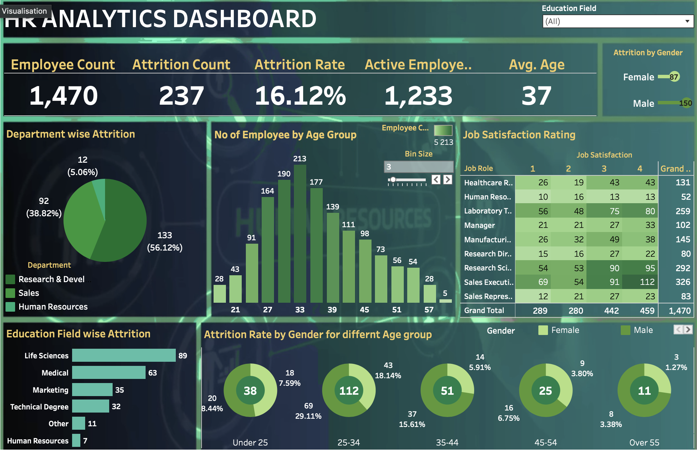

# HR Analytics Dashboard

An interactive Tableau dashboard analyzing employee demographics, attrition factors, and job satisfaction ratings across organizational departments.

## Live Dashboard
🔗 **[View Interactive Tableau Dashboard on Tableau Public](https://public.tableau.com/views/Book1_17864375203440/HRANALYTICSDASHBOARD?:language=en-GB&:sid=&:redirect=auth&:display_count=n&:origin=viz_share_link)**

## Dashboard Preview

## Key Insights Highlighted
- **Overall Attrition:** Total workforce of 1,470 employees with an overall attrition rate of 16.12% (237 count).
- **Department Dynamics:** Research & Development accounted for the highest share of attrition at 56.12% (133 employees), followed by Sales at 38.82% (92 employees).
- **Demographics & Age:** Highest attrition concentration was observed in the 25–34 age group (29.11% male / 7.59% female turnover).
- **Education Field:** Employees with Life Sciences and Medical backgrounds recorded the highest attrition counts (89 and 63 respectively).

## Tools & Skills Showcase
- **Tool:** Tableau Public
- **Features:** Dynamic Filtering, KPI Scorecards, Donut Charts, Binned Age Histograms, Job Satisfaction Cross-tab Matrices.
